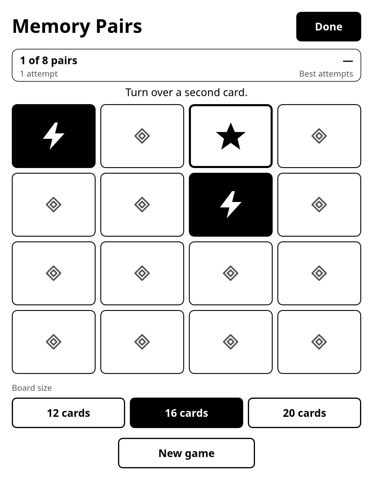
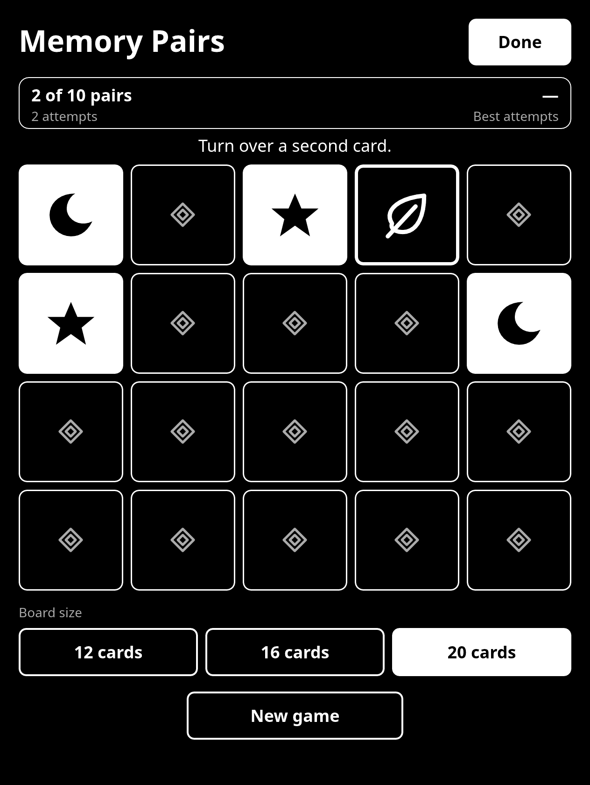

# Memory Pairs

Memory Pairs is an offline matching game for PrimitiveOS. Turn over cards to find ten distinct symbols across three board sizes, and try to beat your fewest attempts.

| 16-card game | 20-card game in dark mode |
| --- | --- |
|  |  |

## How to play

- Turn over a face-down card, then turn over another to look for its match.
- Matched cards stay visible. A mismatch stays visible until you pick a different face-down card.
- Choose a board with 12, 16, or 20 cards. Each board size keeps its own record.
- Open **New game** for another shuffle. You can close the app and resume your current game later.

## Install and preview

Open **Store** from Primitive Launcher and search for **Memory Pairs**. See the [installation guide](INSTALL.md) for package details.

Keep the shared Tools and Launcher repositories alongside this app to render the preview locally.

```sh
cargo test --workspace --locked
cargo run --locked -p memorypairs-desktop -- build/previews
```

## License

The code uses the [PolyForm Noncommercial 1.0.0 license](LICENSE). Documentation, artwork, and screenshots use the [CC BY-NC-SA 4.0 license](LICENSE-DOCS).
